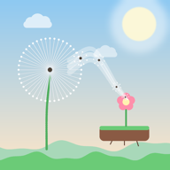
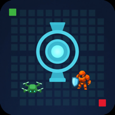
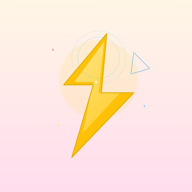
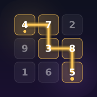
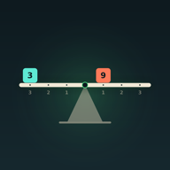
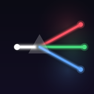

# Puzzle games

Independent casual puzzles · No account required

Small puzzle games you can play offline. Progress stays on your device. Ads, if shown, come from Google AdMob.

**Support:** [tranbang13@gmail.com](mailto:tranbang13@gmail.com) · **Privacy:** [privacy-policy.html](privacy-policy.html)

Tap a store link, or scan **one QR at a time**.

---

## Drift - Wind Seeds

Draw the wind. Land the seeds. 2400 garden puzzles from Easy to Hard.

[App Store](https://apps.apple.com/us/app/drift-wind-seeds/id6825254505) · [Google Play](https://play.google.com/store/apps/details?id=com.tranbang.drift)

&nbsp;&nbsp;&nbsp;&nbsp;&nbsp;&nbsp;&nbsp;&nbsp;&nbsp;&nbsp;&nbsp;&nbsp;

---

## Gridbound Defense

Place towers on a grid. Hold the route through endless waves.

[Google Play](https://play.google.com/store/apps/details?id=com.tranbang.gridbound_defense) · App Store — coming soon

---

## Chớp Chớp Quiz

Đố vui 120 giây: đúng +1 sao, sai về 0. Càng cao càng khó!

[Google Play](https://play.google.com/store/apps/details?id=com.tranbang.chop_chop_quiz) · App Store — coming soon

---

## Number Weave

Weave one path through the grid. Hit the target. 1200 number puzzles from Easy to Hard.

[App Store](https://apps.apple.com/us/app/number-weave/id6819508757) · [Google Play](https://play.google.com/store/apps/details?id=com.numberweave.number_weave)

&nbsp;&nbsp;&nbsp;&nbsp;&nbsp;&nbsp;&nbsp;&nbsp;&nbsp;&nbsp;&nbsp;&nbsp;

---

## One Line Maze

Draw one path. Guide the ball. Dodge moving hazards through 1000 levels.

[App Store](https://apps.apple.com/us/app/one-line-maze-puzzle/id6819576035) · [Google Play](https://play.google.com/store/apps/details?id=com.onelinemaze.one_line_maze)

&nbsp;&nbsp;&nbsp;&nbsp;&nbsp;&nbsp;&nbsp;&nbsp;&nbsp;&nbsp;&nbsp;&nbsp;

---

## Weight Balance

A casual balance puzzle. Progress stays on your device.

[Google Play](https://play.google.com/store/apps/details?id=com.weightbalance.weight_balance) · App Store — coming soon

---

## Light Split

Rotate mirrors. Split the beam. 680 optics puzzles from Easy to Hard.

[Google Play](https://play.google.com/store/apps/details?id=com.lightsplit.light_split) · App Store — coming soon

---

## Trò chơi giải đố

Game giải đố chơi được offline. Tiến trình lưu trên máy. Quảng cáo (nếu có) từ Google AdMob. Liên hệ: [tranbang13@gmail.com](mailto:tranbang13@gmail.com).

| | Game | Cửa hàng |
| --- | --- | --- |
|  | **Drift - Wind Seeds** — vẽ gió, đưa hạt bồ công anh vào vườn | [App Store](https://apps.apple.com/us/app/drift-wind-seeds/id6825254505) · [Google Play](https://play.google.com/store/apps/details?id=com.tranbang.drift) |
|  | **Gridbound Defense** — đặt tháp trên lưới, giữ đường địch qua các wave | [Google Play](https://play.google.com/store/apps/details?id=com.tranbang.gridbound_defense) |
|  | **Chớp Chớp Quiz** — đố vui 120 giây, đúng +1 sao, sai về 0 | [Google Play](https://play.google.com/store/apps/details?id=com.tranbang.chop_chop_quiz) |
|  | **Number Weave** — kéo một đường qua lưới số cho đúng TARGET | [App Store](https://apps.apple.com/us/app/number-weave/id6819508757) · [Google Play](https://play.google.com/store/apps/details?id=com.numberweave.number_weave) |
|  | **One Line Maze** — vẽ một đường, dẫn bóng, tránh chướng ngại | [App Store](https://apps.apple.com/us/app/one-line-maze-puzzle/id6819576035) · [Google Play](https://play.google.com/store/apps/details?id=com.onelinemaze.one_line_maze) |
|  | **Weight Balance** — puzzle thăng bằng | [Google Play](https://play.google.com/store/apps/details?id=com.weightbalance.weight_balance) |
|  | **Light Split** — xoay gương, tách ánh sáng, đưa màu về đích | [Google Play](https://play.google.com/store/apps/details?id=com.lightsplit.light_split) |
